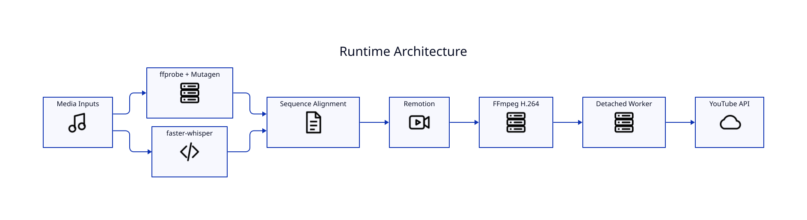

# Architecture

## Pipeline boundaries

LyricVid separates source discovery, lyric intelligence, composition, encoding, background execution, and publishing. This keeps YouTube credentials out of rendering and keeps authored text separate from acoustic timing.

## Input layer

Supported audio discovery includes MP3, WAV, M4A, FLAC, AAC, OGG, and Opus. Artwork accepts PNG, JPG/JPEG, and WebP. Background video accepts MP4, MOV, WebM, and MKV.

## Lyric intelligence

`--lyrics-source` accepts `auto`, `ffprobe`, `embedded`, `sidecar`, or `whisper`. `auto` attempts authored sources and uses Whisper timing. The transcript cache key includes media metadata, model/language, lyric source, and an authored-lyrics fingerprint.

## Composition

The Python CLI stages public assets and a track manifest for the bundled Remotion runtime. The runtime implements intro, active lyrics, section labels, artwork modes, style presets, optional voice-over, and outro.

## Delivery

Remotion renders the composition and FFmpeg/H.264 produces the MP4. The uploader is a separate OAuth-authenticated path using the YouTube Data API.
