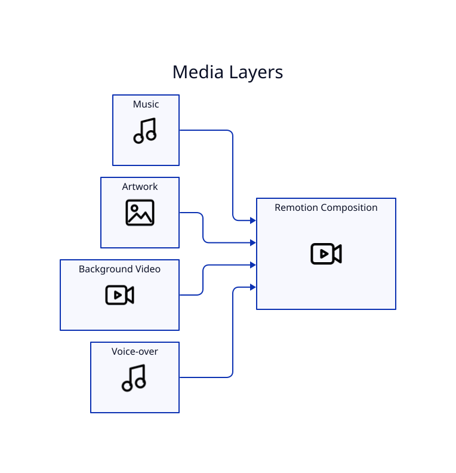

# Artwork and Media

## Artwork

`--image` accepts PNG, JPG/JPEG, or WebP. `--image-mode` controls whether artwork behaves as a full background, a card, or a logo.

## Album-cover workflow

For music releases, combine the cover with `--intro-seconds` and `--outro-seconds`. `--outro-image` can override the main artwork.

## Motion backgrounds

`--background-video` accepts MP4, MOV, WebM, or MKV and is intended for a looping visual bed behind the composition.

## Voice-over

`--voiceover` adds narration. Use `--music-volume` and `--voiceover-volume` to balance layers. This makes LyricVid useful for explainers and narrated visual content in addition to songs.

## Branding

`--brand` controls the top-left label. The default is `Richmack Radio`; `--artist` controls artist metadata.
