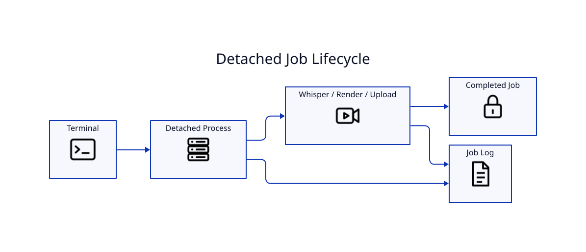

# Background Jobs



`--detach` starts LyricVid independently so closing a terminal or losing an SSH session does not terminate the render/upload.

```bash
lyricvid . --style metro-cinematic --detach
```

LyricVid reports a job ID, PID, and log path. Logs live under:

```text
~/.cache/lyricvid/jobs/
```

## Inspect jobs

```bash
lyricvid jobs
```

## Follow a log

```bash
tail -f ~/.cache/lyricvid/jobs/JOB_ID.log
```

`Ctrl+C` stops `tail`, not the detached worker. High CPU during Whisper inference is expected and is not by itself evidence of a hang.
