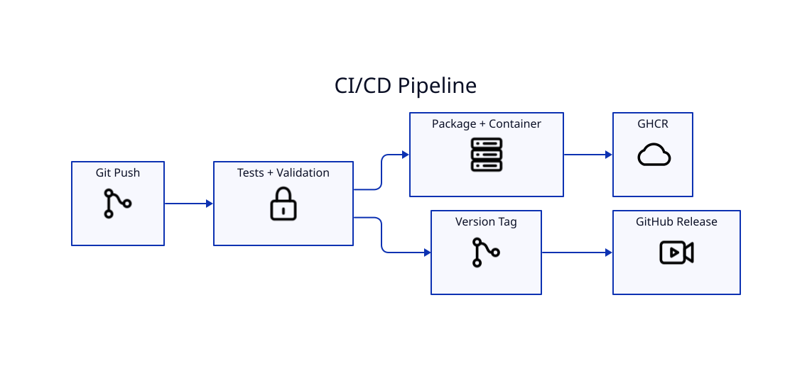

# CI/CD and Releases



## CI gates

The repository validates Python tests, supported Python versions, shell syntax, package metadata/builds, D2 compilation, Docker buildability, credential paths/high-confidence secret patterns, and dependency/security checks.

## Container delivery

Container CD publishes GHCR tags for the project. Credentials for YouTube are deliberately excluded from the image and build context.

## Release delivery

Tagged releases verify version/tag consistency and create package/release assets with provenance/attestation steps.

## Local preflight

```bash
./scripts/validate-no-secrets.sh
pytest -q
./scripts/render-docs.sh
```

## Release

After the tree is clean and CI is green:

```bash
./scripts/tag-release.sh
```

The helper reads the package version and creates/pushes the corresponding annotated tag.
