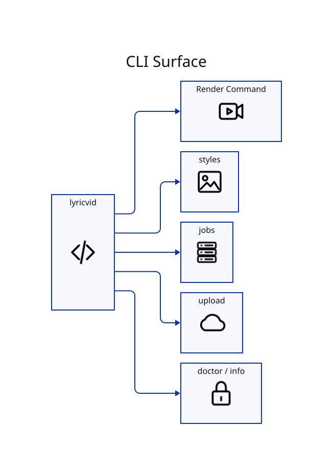

# CLI Reference



## Commands

```text
lyricvid [folder] [render options]
lyricvid styles
lyricvid jobs
lyricvid upload VIDEO [upload options]
```

## Render inputs and lyric controls

| Option | Purpose |
|---|---|
| `--model` | Whisper model; default `small.en` |
| `--language` | language code or `auto` |
| `--lyrics-source` | `auto`, `ffprobe`, `embedded`, `sidecar`, `whisper` |
| `--recursive` | recursively discover audio |
| `--retranscribe` | ignore transcript cache |
| `--transcribe-only` | generate timing data without rendering |
| `--lyrics-info` | report exact lyric sources without transcription |

## Visual and media controls

| Option | Purpose |
|---|---|
| `--image` | artwork |
| `--image-mode` | `background`, `card`, `logo` |
| `--artist` | explicit artist display |
| `--brand` | top-left brand; default Richmack Radio |
| `--intro-seconds` | prepend cover-art intro |
| `--outro-seconds` | append outro |
| `--outro-image` | separate outro art |
| `--outro-text` | outro copy |
| `--background-video` | looping motion background |
| `--voiceover` | narration layer |
| `--music-volume` | music gain 0–1 |
| `--voiceover-volume` | narration gain 0–1 |
| `--style` | named preset |
| `--layout` | `cyber`, `minimal`, `terminal` |
| `--format` | `landscape`, `short`, `square` |
| `--crf` | H.264 CRF; default 24 |

## Runtime controls

`--device`, `--compute-type`, `--threads`, `--jobs`, `--output`, `--force`, `--studio`, `--doctor`, `--clean-cache`, and `--detach` control execution and diagnostics.

## Upload controls

`lyricvid upload` requires a video and title. It supports description text/file, comma-separated tags, category, public/unlisted/private behavior, credential/token paths, resumable chunk size, dry-run, and detached execution. See [[YouTube-Publishing]].
