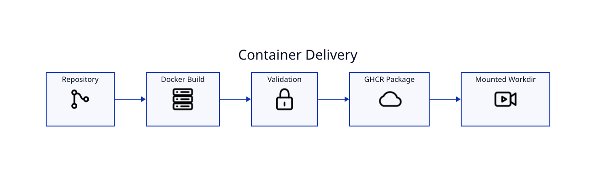

# Container and GHCR



LyricVid ships a Dockerfile and a GHCR publishing workflow. The image is useful when you want a reproducible CLI/runtime boundary.

Example render pattern:

```bash
docker run --rm \
  -v "$PWD:/work" \
  ghcr.io/iamrichmack111/lyricvid-cli:latest \
  . --style cyberpunk
```

Do not copy `.secrets` into an image. If containerized YouTube upload is required, mount credentials only at runtime and keep them outside the build context.

Container CI should build the image on normal changes; publishing belongs to the CD workflow.
