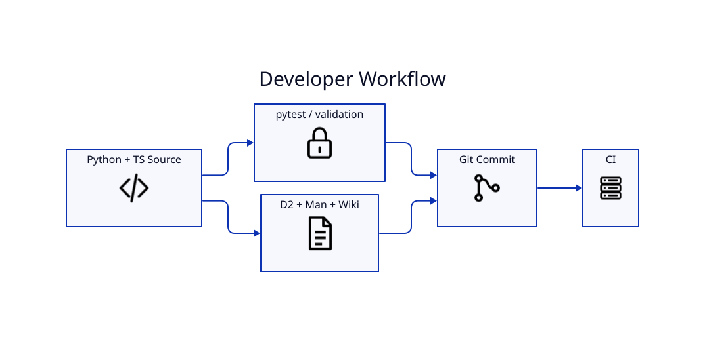

# Developer Guide



## Source layout

- `src/lyricvid/cli.py` — CLI, lyric resolution/alignment, orchestration, YouTube upload
- `src/lyricvid/remotion_runtime/` — Remotion package and composition source
- `tests/` — Python tests
- `docs/` — man page and architecture source
- `scripts/` — documentation, metadata, validation, issue/history, and release helpers
- `.github/workflows/` — CI, release, and container automation

## Development loop

```bash
python -m pytest -q
lyricvid --doctor
./scripts/render-docs.sh
./scripts/validate-no-secrets.sh
```

## Runtime versioning

When bundled Remotion runtime behavior changes, keep the Python/package/runtime version markers coherent so cached runtimes are rebuilt when required.

## Documentation rule

Implemented behavior belongs in README/wiki/manpage. Future behavior belongs on [[Roadmap]].
