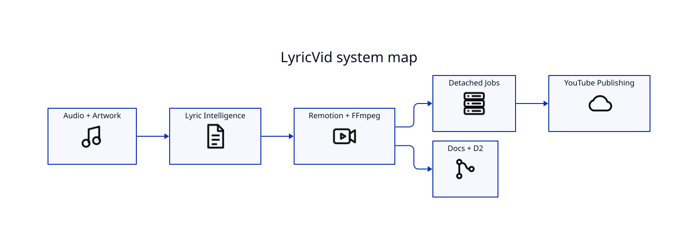

# LyricVid Wiki

LyricVid is a terminal-driven production pipeline for Whisper-aligned lyric videos, album-art visualizers, narrated explainers, social video formats, detached rendering, and secure YouTube publishing.

## Start here

- **New user:** [[Installation]] → [[Quick-Start]] → [[Visual-Styles]]
- **Music workflow:** [[Lyric-Pipeline]] → [[Whisper-Alignment]] → [[Remotion-Rendering]] → [[YouTube-Publishing]]
- **Operator workflow:** [[Background-Jobs]] → [[Troubleshooting]] → [[Security]]
- **Maintainer workflow:** [[Architecture]] → [[CI-CD-and-Releases]] → [[Developer-Guide]]

## Core design

LyricVid prefers authored lyric text when available and uses faster-whisper primarily for acoustic timing. ffprobe and Mutagen inspect metadata, sidecars can provide exact text, sequence alignment reconciles authored tokens with detected word timestamps, Remotion creates the composition, and FFmpeg produces H.264 output.

## Current release documented

This wiki describes **v0.9.0**. Planned functionality is kept on [[Roadmap]] and is not presented as implemented.
