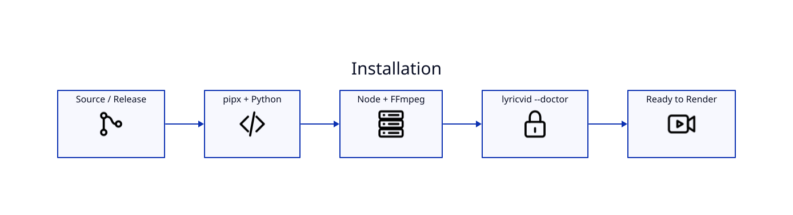

# Installation



## Requirements

- Python 3.10+
- `pipx`
- Node.js and npm
- FFmpeg / ffprobe
- D2 only for rebuilding documentation diagrams
- Google OAuth Desktop credentials only for YouTube uploads

## macOS

```bash
brew install ffmpeg pipx d2
pipx ensurepath
```

From a source checkout:

```bash
./install.sh
lyricvid --version
lyricvid --doctor
```

`install.sh` includes recovery logic for the stale pipx/uv environment problem encountered during upgrades.

## Verify the toolchain

```bash
lyricvid --doctor
ffmpeg -version
ffprobe -version
node --version
npm --version
```

## First-run behavior

The Remotion runtime is installed under the LyricVid cache. faster-whisper may also download the selected model on first use. A Hugging Face authentication warning does not itself indicate failure; model inference can use substantial CPU.

## Man page

```bash
man lyricvid
```

See [[Troubleshooting]] for pipx, npm, D2, FFmpeg, Whisper, and OAuth failures.
