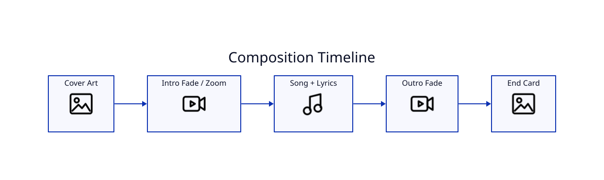

# Intro and Outro



## Intro

`--intro-seconds N` prepends a cover-art scene and delays audio/lyrics by the same duration. This enables fade/zoom treatments without sacrificing the opening lyric.

## Outro

`--outro-seconds N` extends the composition after the song. By default it can reuse the main image; `--outro-image` provides a separate asset and `--outro-text` controls the message.

## Example

```bash
lyricvid . \
  --image cover.png \
  --intro-seconds 5 \
  --outro-seconds 7 \
  --outro-text "COMPETE FOR YOU — ESOTERICA"
```

Keep intro/outro durations deliberate: they become part of the final video duration and influence viewer retention.
