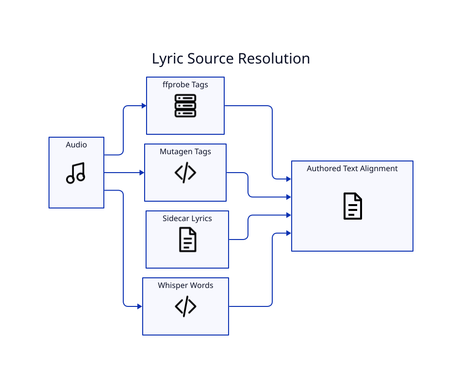

# Lyric Pipeline

## Goal

The displayed lyric should preserve the author's spelling, punctuation, capitalization, and section structure while acoustic recognition supplies timing.

## Source order

LyricVid can inspect ffprobe/container metadata, Mutagen-readable embedded tags, and sidecar files. Sidecar candidates include `.lyrics.txt`, `.txt`, and `.lyrics` forms associated with the song.

## Embedded metadata

The implementation understands common synchronized/unsynchronized ID3 frames and lyric-like MP4/Vorbis/FLAC mappings. SYLT text can be used as authored text while Whisper remains the timing authority.

## Whisper-only mode

`--lyrics-source whisper` intentionally skips authored lyric resolution. This is useful when no reliable authored text exists, but recognition errors then become display text.

## Caching

Transcripts are cached under `~/.cache/lyricvid/transcripts`. Changes to the source file, model, language, authored lyric text, or source selection alter the cache fingerprint.

## QA

The prepared output includes alignment information that can be reviewed before publishing. Use `--transcribe-only` during lyric QA to avoid paying the rendering cost repeatedly.
