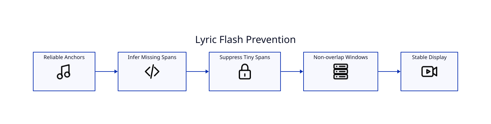

# Preventing Lyric Flashing

## Symptom

A lyric appears briefly before the matching phrase is actually sung, or a line flashes between two correctly timed lines.

## Cause

This usually occurs when authored text must be inferred between Whisper timing anchors and an inferred span is too short or overlaps a neighboring active window.

## Current mitigation

LyricVid uses conservative, non-overlapping line display windows and suppresses extremely short inferred-only spans. The active-word treatment can still follow word timestamps while line visibility remains stable.

## Operator checklist

1. Run `--transcribe-only --retranscribe`.
2. Check whether the authored lyric sidecar matches the recording exactly.
3. Remove accidental duplicate lines or unsung annotations.
4. Render a short validation pass.
5. Inspect verse/chorus transitions and fast phrases.

Do not fix timing by changing correct lyric text to match a Whisper hallucination; authored text and acoustic timing have separate responsibilities.
