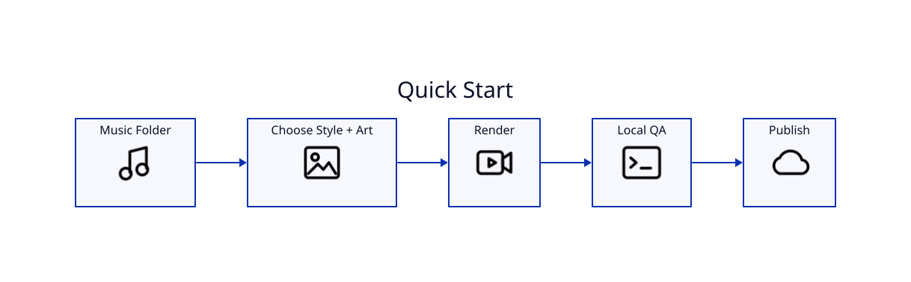

# Quick Start



## Render a folder

```bash
cd /path/to/music
lyricvid .
```

## Render with artwork and a style

```bash
lyricvid . \
  --style metro-cinematic \
  --image cover.png \
  --artist "Esoterica" \
  --brand "Richmack Radio" \
  --intro-seconds 5 \
  --outro-seconds 7 \
  --outro-text "COMPETE FOR YOU — ESOTERICA"
```

## Detach a long render

```bash
lyricvid . --style cyberpunk --detach
lyricvid jobs
```

## Inspect lyric sources without rendering

```bash
lyricvid . --lyrics-info
```

## List styles

```bash
lyricvid styles
```

## Recommended first production

Use a private YouTube upload before public publishing. See [[YouTube-Production-Workflow]].
