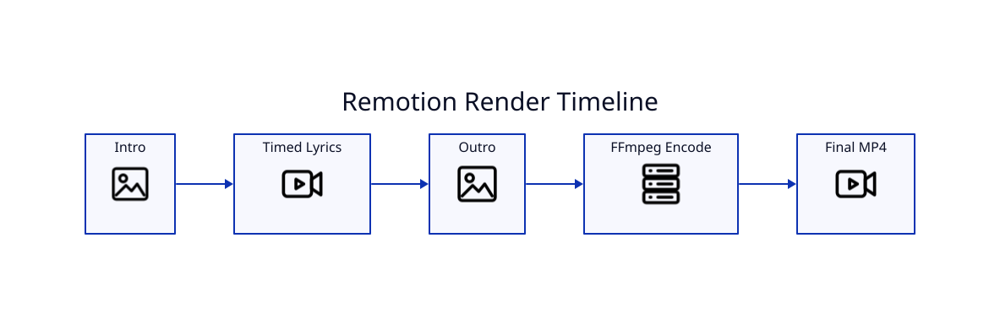

# Remotion Rendering

## Runtime

LyricVid bundles a Remotion runtime under the Python package and copies it into `~/.cache/lyricvid/remotion-runtime` when needed. npm dependencies are installed on first setup or when the runtime version changes.

## Composition phases

1. Optional cover-art intro.
2. Main composition with brand, metadata, section labels, artwork/background, and timed lyrics.
3. Optional cover-art outro.

Intro duration shifts audio/lyric timing so the first sung line is not consumed by the cover scene.

## Formats

- `landscape`: 1280×720
- `short`: 1080×1920
- `square`: 1080×1080

## Encoding

`--crf` controls H.264 quality/size tradeoff. Lower CRF generally increases quality and file size.

## Studio

Use `--studio` to prepare the project and open Remotion Studio for visual iteration before committing to a full render.
