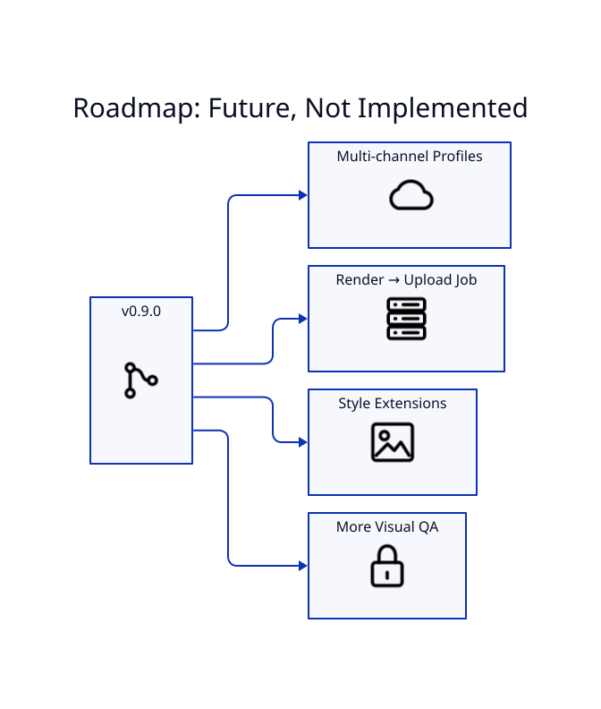

# Roadmap



This page lists ideas, **not current functionality**.

## Planned: multiple YouTube channel profiles

Proposed interface:

```text
lyricvid youtube auth --profile richmack-radio
lyricvid youtube auth --profile esoterica
lyricvid youtube profiles
lyricvid youtube whoami --profile esoterica
lyricvid upload video.mp4 --youtube-profile esoterica ...
```

The design should isolate each channel's token under a global per-profile configuration directory and provide an identity check before publication.

## Other candidates

- one-command detached render → upload pipeline
- richer style/plugin extension points
- additional visual QA automation
- more explicit channel-safe publishing confirmations

Roadmap entries should become normal documentation only after implementation and tests land.
