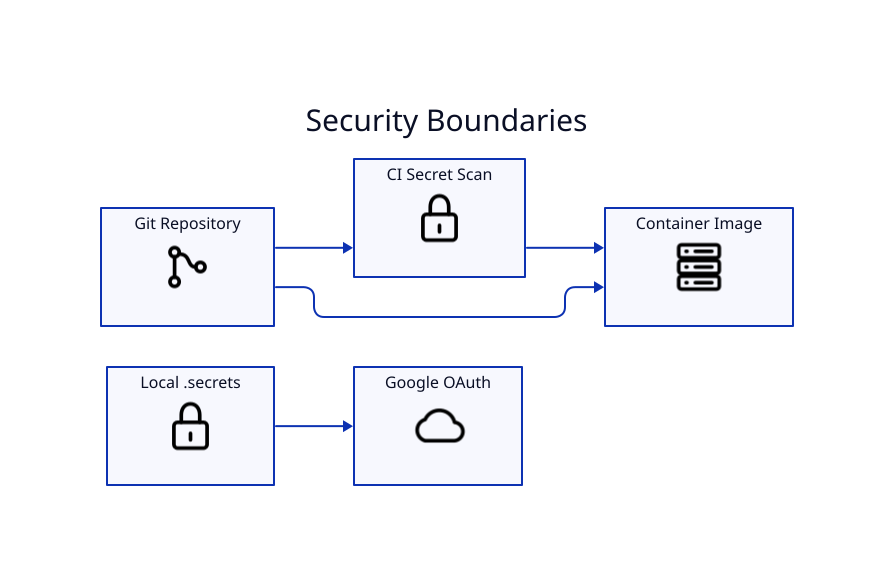

# Security



## Credential boundary

YouTube OAuth is a local runtime concern. CI/CD does not require Google credentials. Never bake credentials into the GHCR image or commit them to the repository.

Never track:

```text
.secrets/
client_secret_*.json
youtube-oauth.json
youtube-token.json
credentials.json
```

## Repository validation

```bash
./scripts/validate-no-secrets.sh
```

CI additionally performs dependency/security validation with tools such as pip-audit, Bandit, and npm audit.

## If a secret is committed

Deleting it in a later commit is not enough. Revoke/rotate the credential and remove the sensitive value from published Git history.

## File permissions

OAuth/token files should be user-readable only where practical (`chmod 600`).

See the repository `SECURITY.md` for reporting policy.
