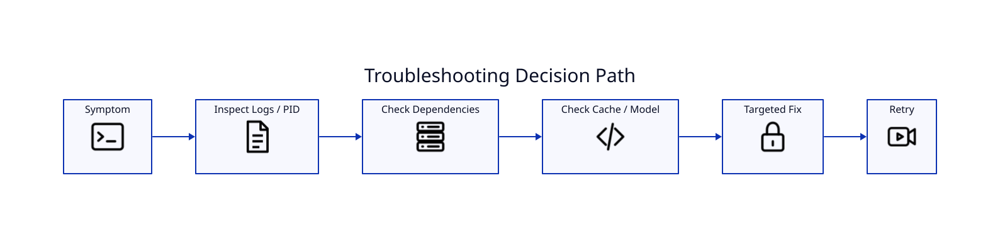

# Troubleshooting

## Render appears hung

Check the detached PID and CPU usage. Whisper can consume several cores. Inspect the job log and Hugging Face/LyricVid cache growth before killing the process.

## Hugging Face warning

Unauthenticated HF Hub requests can have lower rate limits. The warning is not itself a transcription failure.

## npm/esbuild warning

An npm `allow-scripts` warning is not necessarily fatal. Judge success by the command exit status and subsequent runtime/render output.

## OAuth credentials not found

The current uploader defaults to `.secrets/youtube-oauth.json`. Confirm the file exists locally and is not tracked by Git.

## pipx says the environment exists

Use the current `install.sh`, which contains stale LyricVid pipx/uv recovery logic.

## D2 fails to compile

Run `d2 validate` or compile the failing `.d2` directly. Avoid reserved identifiers in edge paths.

## YouTube initially shows 360p

Check the local MP4 dimensions with ffprobe and allow YouTube time to complete HD transcoding.
