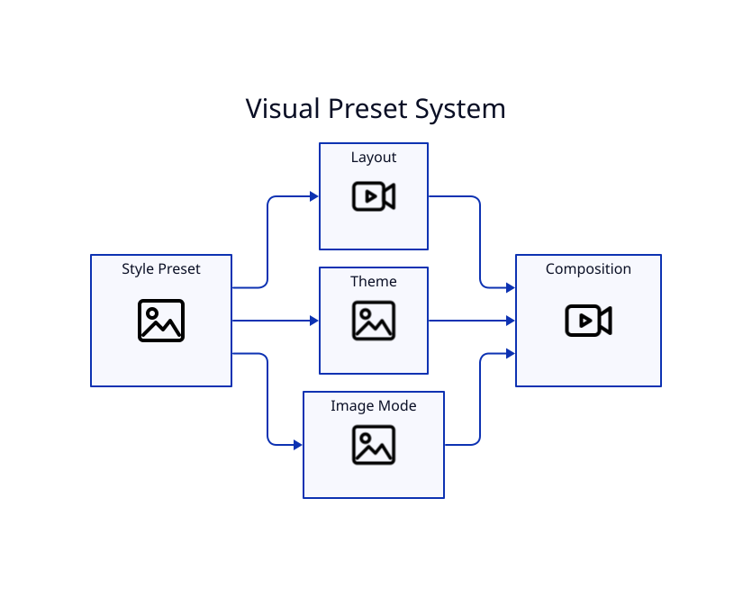

# Visual Styles

Run `lyricvid styles` to see the installed presets.

| Style | Intended treatment |
|---|---|
| `cyberpunk` | blue/violet neon, grid, particles |
| `terminal-green` | green/cyan terminal aesthetic |
| `daemon-red` | red/orange infrastructure mood |
| `root-violet` | violet/magenta cinematic neon |
| `system-amber` | amber/orange retro computing |
| `network-teal` | teal/blue networking/cloud |
| `neon-pink` | pink/cyan social-first neon |
| `minimal-clean` | reduced effects, centered artwork |
| `podcast` | card-oriented narration/audio-show layout |
| `explainer` | logo/diagram-forward technical layout |
| `metro-cinematic` | soft metro motion, film grain, restrained neon |

A style preset selects layout, theme, and image mode together. Explicit low-level controls are useful when creating a custom variation.
