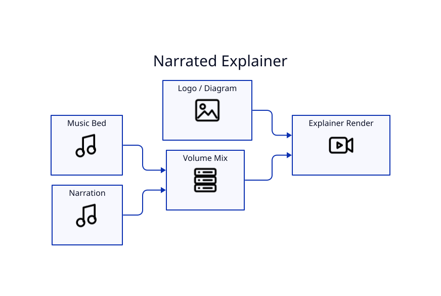

# Voice-over and Explainers



LyricVid can combine a primary music/audio source with a separate narration layer.

```bash
lyricvid . \
  --style explainer \
  --image diagram.png \
  --voiceover narration.mp3 \
  --music-volume 0.35 \
  --voiceover-volume 1.0
```

## Suggested uses

- technical explainers
- command-line tutorials
- narrated diagrams
- podcast/audiogram clips
- branded social posts

Use `podcast`, `explainer`, or `minimal-clean` when readability matters more than high-energy lyric effects.
