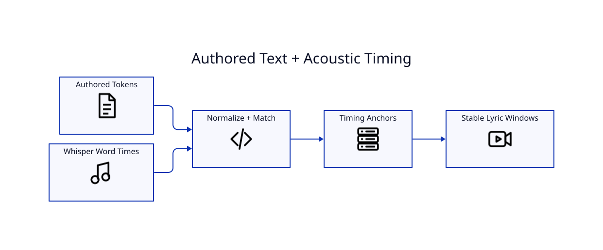

# Whisper Alignment



## Why alignment exists

Whisper is good at finding *when* words are spoken, but authored lyrics are often better for *what* should be displayed. LyricVid tokenizes the authored text and detected words, normalizes them for matching, and reconciles the two sequences.

## Word timestamps

The transcription path requests word-level timing. Authored lines are then reconstructed around matched timing anchors.

## Section markers

Markers such as `[Verse 1]`, `[Chorus]`, `[Bridge]`, and `[Outro]` are treated as structural labels rather than ordinary sung lyric lines.

## Inferred timing

Not every authored token has a direct acoustic match. Timing can be inferred between reliable anchors. Conservative display windows are used to reduce brief incorrect activations.

## Debug workflow

```bash
lyricvid . --transcribe-only --retranscribe
```

Review the generated timing/alignment data, correct the authored sidecar if needed, and render only after the alignment looks reasonable.
