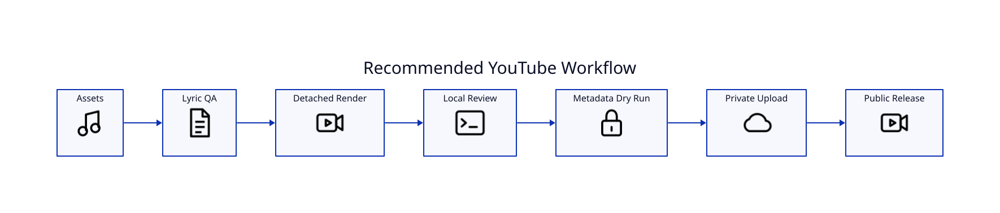

# YouTube Production Workflow



## 1. Prepare assets

Keep the song, authored lyrics, cover art, and `description.md` together in a production folder. Keep `.secrets/` local and ignored.

## 2. Validate lyrics

```bash
lyricvid . --lyrics-info
lyricvid . --transcribe-only
```

Correct authored text before rendering.

## 3. Render detached

```bash
lyricvid . \
  --style metro-cinematic \
  --image cover.png \
  --artist "Esoterica" \
  --brand "Richmack Radio" \
  --intro-seconds 5 \
  --outro-seconds 7 \
  --force \
  --detach
```

Use `lyricvid jobs` and inspect the job log.

## 4. Local QA

Watch the intro, first verse, section transitions, midpoint, fast passages, and outro. Confirm resolution with ffprobe.

## 5. Metadata dry-run

Use `lyricvid upload ... --dry-run` and inspect title, description, tags, category, and privacy.

## 6. Private test

Perform the first real upload privately. Check YouTube processing and metadata.

## 7. Public release

Repeat with `--public` only after the private result is correct.

## 8. Documentation

Use the Playwright screenshot helper to capture representative frames for README/wiki documentation when appropriate.
