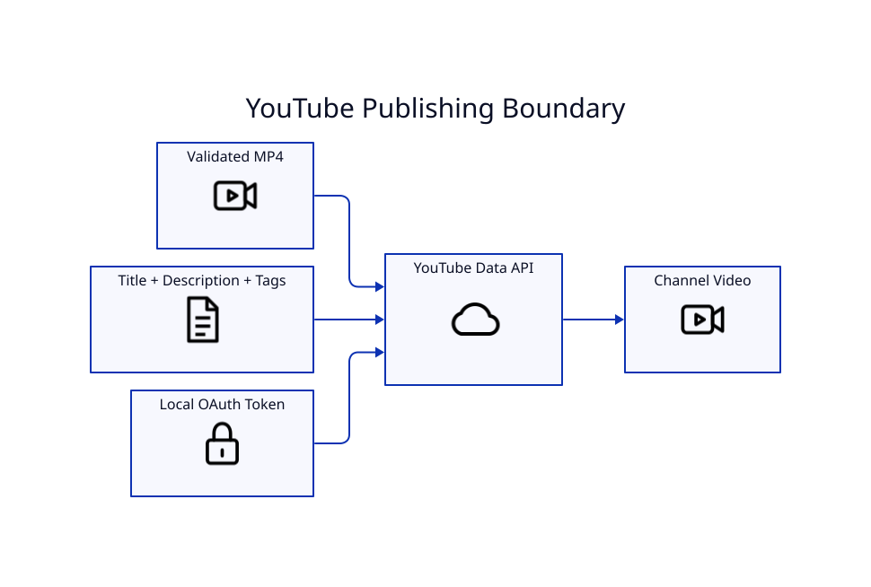

# YouTube Publishing



## OAuth setup

Create a Google OAuth Desktop client with YouTube Data API v3 enabled. Keep the downloaded JSON local. The current default paths are:

```text
.secrets/youtube-oauth.json
.secrets/youtube-token.json
```

Never commit either file.

## Validate without uploading

```bash
lyricvid upload video.mp4 \
  --title "Title" \
  --description-file description.md \
  --tags "tag one,tag two" \
  --dry-run
```

## Private first upload

Omit `--public` and `--unlisted`; private is the default. This is the recommended first OAuth/metadata test.

## Public upload

```bash
lyricvid upload video.mp4 \
  --title "Esoterica - Compete for You | Official Lyric Video" \
  --description-file description.md \
  --tags "Esoterica,Compete for You,R&B,lyric video,Richmack Radio" \
  --public
```

Uploads are resumable and use an 8 MiB default chunk size. `--detach` is appropriate after OAuth has already been established.

## HD processing

YouTube may expose a low-resolution transcode before HD processing completes. Verify the local MP4 dimensions with ffprobe before assuming a 360p option means the source render was low resolution.

## Multiple channels

Named multi-channel profiles are **not implemented yet**. They are tracked on [[Roadmap]]. Do not share one cached token casually between channel identities.
